# 🛍️ TrendOne Customer Analytics
### Customer Behavior Analysis · Statistical Testing · Exploratory Segmentation

<p align="center">
  
</p>

<p align="center">
  
  
  
  
  
</p>

<p align="center">
  <b>An end-to-end customer analytics portfolio project focused on turning customer shopping data into interpretable findings, exploratory customer profiles, and actionable business recommendations.</b>
</p>

<p align="center">
  <a href="#-project-overview">Overview</a> •
  <a href="#-key-findings">Key Findings</a> •
  <a href="#-dashboard-preview">Dashboard</a> •
  <a href="#-repository-structure">Repository</a>
</p>

---

## 📌 Project Overview

How can a business better understand customer purchasing behavior when the available data provides only a limited view of its customers?

**TrendOne Customer Analytics** explores this question through data quality assessment, exploratory data analysis, statistical hypothesis testing, SQL-based analysis, K-Means clustering, and Power BI reporting.

The project examines whether recorded purchase amounts differ across selected customer groups, investigates the relationship between subscription status and discount usage, and explores whether customers can be grouped into interpretable profiles using selected numerical features.

Rather than treating every observed pattern as a business conclusion, the analysis distinguishes statistically supported findings from hypotheses that require further validation.

> **Business case disclosure:** TrendOne Co. is a simulated business case developed for this portfolio project. The analysis does not represent employment, consulting work, or verified business outcomes for an actual company.

### 🎯 Objectives

- 🔎 Assess data quality and determine which business questions the dataset can support.
- 📊 Explore customer characteristics and purchasing behavior.
- 🧪 Apply appropriate statistical tests and effect sizes to evaluate group differences and associations.
- 🧩 Develop exploratory customer profiles using K-Means clustering.
- 🗄️ Use SQL to validate data and answer structured business questions.
- 📈 Communicate analytical results through an interactive Power BI dashboard.
- 💡 Translate findings into practical recommendations while documenting data and methodological limitations.

### 🧰 Tools & Technologies

| Tool                          | Application                                             |
|-------------------------------|---------------------------------------------------------|
| Python                        | Data preparation, EDA, statistical analysis, clustering |
| Pandas & NumPy                | Data manipulation and numerical operations              |
| SciPy / pingouin              | Hypothesis testing and statistical calculations         |
| Scikit-learn                  | K-Means clustering and cluster evaluation               |
| SQL / PostgreSQL              | Data validation, customer metrics, business queries     |
| Power BI                      | Interactive dashboard and business reporting            |
| Jupyter Notebook              | Reproducible analytical workflow                        |
| GitHub                        | Project documentation                                   |
| FigJam                        | Analytical workflow and architecture diagrams           |


---

## 📊 Key Findings

The analysis produced three primary findings.

<table>
  <tr>
    <td width="33%" align="center">
      <h3>3,900</h3>
      <b>Customer Records</b>
      <br>
      <sub>18 columns in the provided dataset</sub>
    </td>
    <td width="33%" align="center">
      <h3>0.70</h3>
      <b>Cramér's V</b>
      <br>
      <sub>Strong subscription–discount association</sub>
    </td>
    <td width="33%" align="center">
      <h3>6</h3>
      <b>Exploratory Clusters</b>
      <br>
      <sub>Silhouette score: 0.2864</sub>
    </td>
  </tr>
</table>

### 1. 📉 No Statistically Significant Purchase Amount Differences Were Detected

The tests did not detect statistically significant purchase amount differences across the demographic and customer groups examined, including age group, gender, region, product category, discount usage, and subscription status.

The reported effect sizes were also very small.

**Interpretation:** The available evidence does not show meaningful purchase amount differences across these groups in this dataset. This does not prove that the groups are identical or that the variables are irrelevant in every business context.

### 2. 🎟️ Subscription Status and Discount Usage Were Strongly Associated

The chi-square test of independence produced the following results:

| Statistic            | Result   |
|----------------------|---------:|
| Chi-square statistic | 1,908.92 |
| Degrees of freedom   | 1        |
| p-value              | < 0.001  |
| Cramér's V           | 0.700    |

**Interpretation:** Subscription status and discount usage were strongly associated in the analyzed data.

This relationship warrants further investigation into discount eligibility rules, subscription benefits, and the underlying data structure. The association does not establish causality, and the pattern should be checked against the original data source before being treated as a real-world business insight.

### 3. 🧩 Six Exploratory Customer Profiles Were Identified

K-Means clustering produced six profiles based on selected numerical customer features.

The final model achieved a silhouette score of **0.2864**, suggesting limited separation between clusters.

**Interpretation:** The profiles provide a starting point for further investigation, but they are not validated customer personas. Their usefulness for campaign targeting, customer prioritization, or other operational decisions would need to be tested.

---

## 🧭 Business Questions

The project is organized around four analytical areas.

| Business Area             | Key Questions                                                                                                                   |
|---------------------------|---------------------------------------------------------------------------------------------------------------------------------|
| 💰 Customer Value        | Which observed characteristics are associated with purchase amount? Do recorded purchase amounts differ across customer groups? |
| 🛒 Product & Promotions  | How does purchase amount vary by product category? Is discount usage associated with purchasing behavior?                       |
| 🤝 Customer Engagement   | Does purchase amount differ by subscription status? How strongly are subscription status and discount usage associated?         |
| 🔄 Customer Retention    | Can retention be measured from the available data? Can exploratory customer profiles be identified?                             |

### Important Scope Decision

Actual customer retention over time cannot be measured reliably because the dataset does not contain transaction timestamps or longitudinal customer activity records.

Previous Purchases and Frequency of Purchases are treated as recorded behavioral attributes, not substitutes for time-based retention metrics.

📄 **Detailed documentation:** [`docs/02_business_questions.md`](docs/02_business_questions.md)

---

## 🔄 Analytical Workflow

The project follows a structured workflow, from business understanding to communication of findings.

<p align="center">
  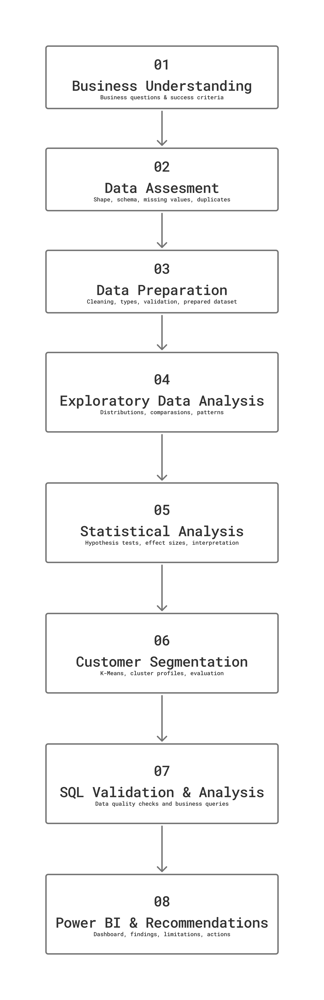
</p>

### Workflow Stages

1. **Business Understanding** - Define the business context, analytical objectives, and key questions.
2. **Data Assessment** - Review the dataset structure, data types, missing values, uniqueness, and analytical feasibility.
3. **Data Preparation** - Prepare the data and derived variables for consistent analysis.
4. **Exploratory Data Analysis** - Examine distributions, group patterns, and potential relationships.
5. **Statistical Analysis** - Apply appropriate tests, evaluate effect sizes, and interpret results.
6. **Customer Segmentation** - Develop exploratory profiles and assess cluster quality.
7. **SQL Analysis & Validation** - Run structured queries and compare relevant outputs with Python.
8. **Business Intelligence & Recommendations** - Present findings and limitations through Power BI and project documentation.

The sequence represents the overall analytical workflow. Some activities, such as SQL analysis and Python analysis, can be performed in parallel.

### 🏗️ Data Architecture

<p align="center">
  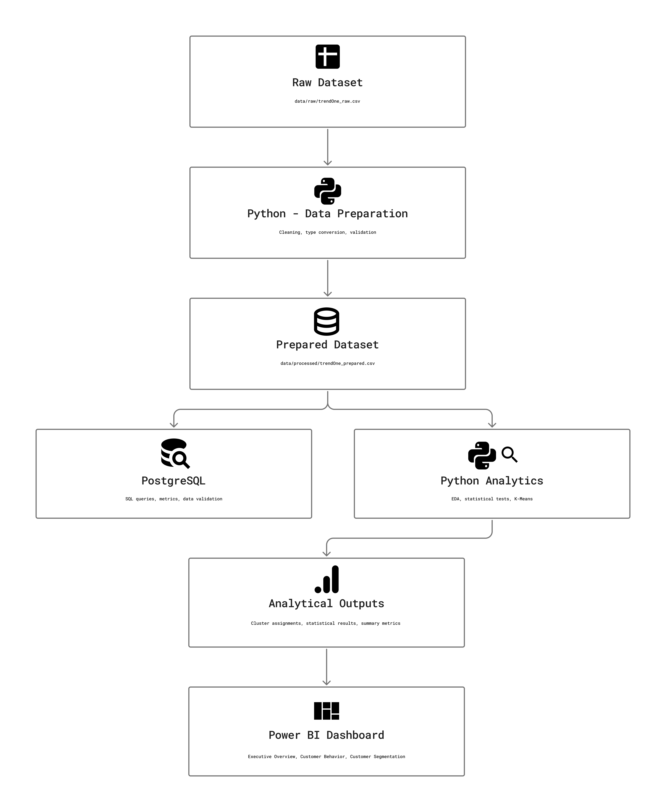
</p>

The workflow starts with the raw dataset, produces a prepared dataset, and uses the prepared data for analysis and reporting. Python, SQL, and Power BI serve complementary roles in the project.

---

## 🧹 Data Understanding & Preparation

### Dataset Summary

| Attribute                         | Result                                                  |
|-----------------------------------|---------------------------------------------------------|
| Rows                              | 3,900                                                   |
| Columns                           | 18                                                      |
| Unique Customer IDs               | 3,900                                                   |
| Exact duplicate rows              | None detected                                           |
| Missing Review Rating values      | 37                                                      |
| Missing Review Rating percentage  | Approximately 0.95%                                     |
| Data granularity                  | One record per customer identifier in the provided file |

### Data Quality Decisions

- Customer ID is treated as an identifier rather than a numerical measurement.
- Exact duplicate records were checked during data assessment.
- Missing Review Rating values are preserved as missing rather than replaced with zero.
- Age Group is derived from age for grouped analysis and reporting.
- The available columns and data granularity are evaluated against the intended business questions before analysis.

### Data Preparation Flow

```text
Raw Dataset
    ↓
Data Assessment
    ↓
Data Cleaning & Preparation
    ↓
Prepared Dataset
    ├── Exploratory Data Analysis
    ├── Statistical Analysis
    ├── Customer Segmentation
    ├── SQL Analysis
    └── Power BI Reporting
```

📄 **Related documentation:**
- [Data Requirements](docs/03_data_requirements.md)
- [Data Assessment](docs/04_data_assessment.md)
- [Data Preparation](docs/05_data_preparation.md)


---

## 🧪 Statistical Analysis

Statistical methods were selected based on the types of variables and the questions being investigated.

| Analytical Scenario                       | Method                          | Purpose                                              |
|-------------------------------------------|---------------------------------|------------------------------------------------------|
| Two numerical variables                   | Spearman correlation            | Evaluate monotonic association                       |
| Numerical outcome, two independent groups | Welch's t-test                  | Compare group means without assuming equal variances |
| Numerical outcome, more than two groups   | Welch's ANOVA                   | Compare group means without assuming equal variances | 
| Two categorical variables                 | Chi-square test of independence | Evaluate categorical association                     |

### Statistical Decision Flow

<p align="center">
  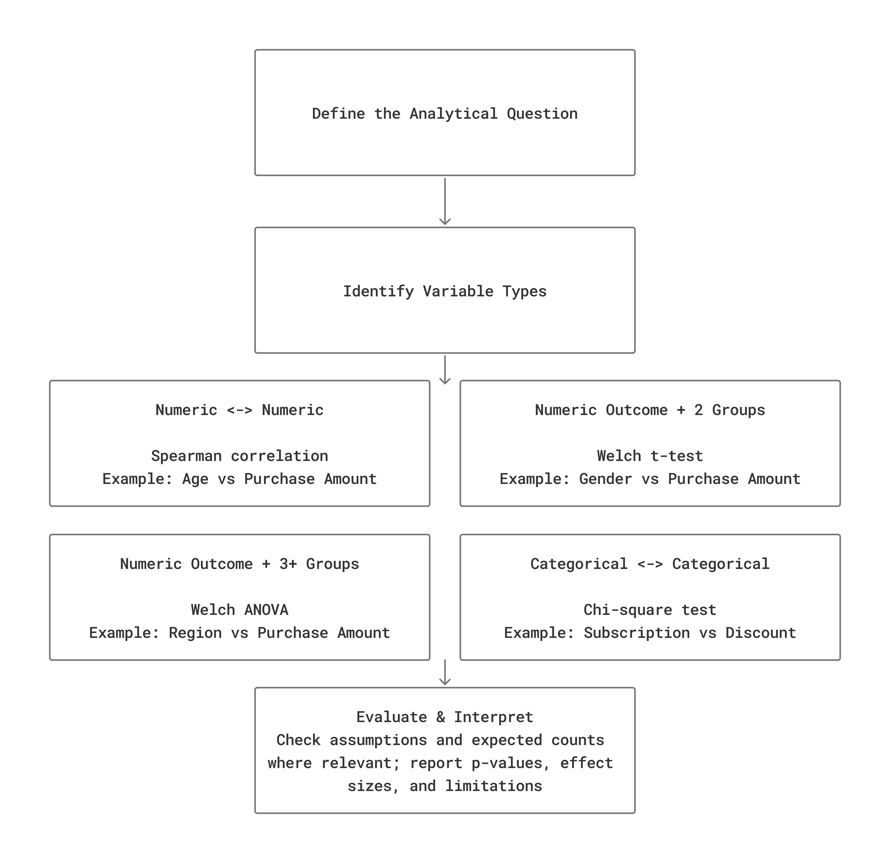
</p>

### Interpretation Principles

- Significance threshold: $\alpha = 0.05$. 
- Effect sizes are considered alongside p-values.
- Statistical significance is not equivalent to business importance.
- Association does not establish causality.
- Non-significant results do not prove that no relationship exists.
- The validity of the tests depends on the assumptions and structure of the available data.


---

## 🧩 Customer Segmentation

### Model Configuration

| Parameter                 | Value   |
|---------------------------|---------|
| Algorithm                 | K-Means |
| Number of clusters        | 6       |
| Random state              | 42      |
| Number of initializations | 20      |
| Silhouette score          | 0.2864  |

The clusters are exploratory profiles derived from selected numerical features. They should not be interpreted as validated measures of customer loyalty, profitability, or retention.

### Cluster Profile Summary

| Cluster | Customers | Avg. Purchase Amount | Avg. Previous Purchases | Avg. Review Rating |
|---------|----------:|---------------------:|------------------------:|-------------------:|
| C0      | 647       | $76.00               | 12.11                   | 4.34               |
| C1      | 673       | $45.99               | 38.88                   | 3.15               |
| C2      | 665       | $39.48               | 11.90                   | 3.31               |
| C3      | 646       | $80.33               | 39.76                   | 4.22               |
| C4      | 625       | $82.77               | 20.78                   | 3.06               |
| C5      | 644       | $35.84               | 28.39                   | 4.43               | 
 
### Initial Observations

- **C3:** Higher average purchase amount and the highest average previous purchase count among the six clusters.
- **C4:** Highest average purchase amount, alongside the lowest average review rating.
- **C5:** Lowest average purchase amount, alongside the highest average review rating.
- **C0:** Higher average purchase amount despite a relatively low average previous purchase count.

These are descriptive patterns, not explanations of why customers behave differently.

### Model Limitations

The silhouette score of 0.2864 indicates limited cluster separation. A separate initialization-sensitivity experiment also showed that assignments varied across tested initializations.

Further validation should examine alternative feature sets, scaling choices, cluster counts, stability, interpretability, and relevance to measurable business outcomes.

📓 **Notebook:** [`notebooks/05_customer_segmentation.ipynb`](notebooks/05_customer_segmentation.ipynb)

---

## 📈 Dashboard Preview

The Power BI dashboard translates the analytical outputs into a business-facing reporting experience.

### Executive Overview

<p align="center">
  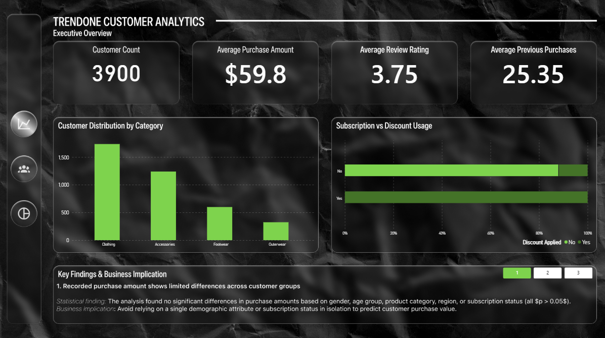
</p>
<p align="center">
  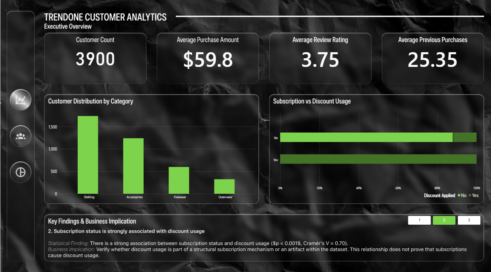
</p>
<p align="center">
  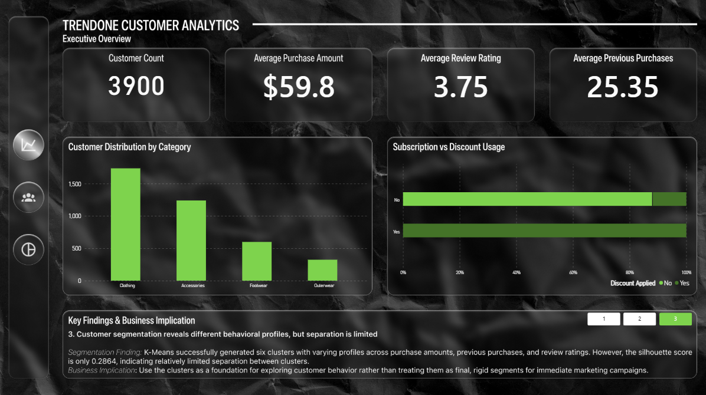
</p>

**What this page communicates:**
- Overall customer snapshot.
- Average recorded purchase amount and review rating.
- Subscription and discount usage patterns.
- Key findings and interpretation cautions.

### Customer Behavior

<p align="center">
  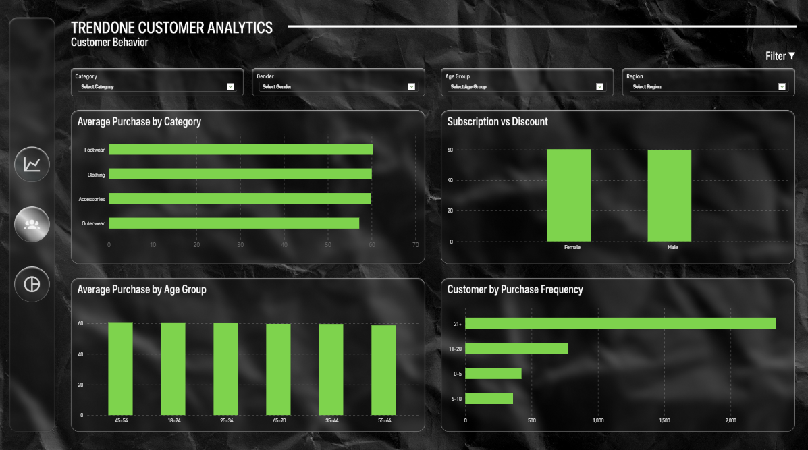
</p>

**What this page communicates:**
- Purchase amount across selected customer groups.
- Customer distribution across product categories and demographic groups.
- Recorded purchasing attributes available in the dataset.

### Customer Segmentation

<p align="center">
  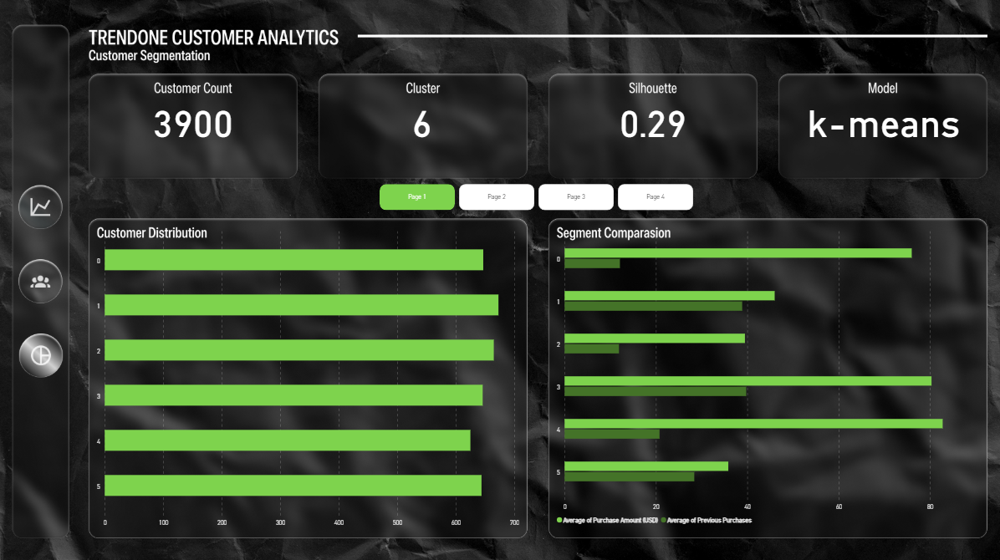
</p>
<p align="center">
  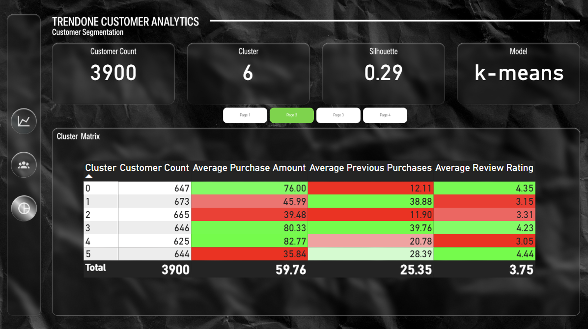
</p>
<p align="center">
  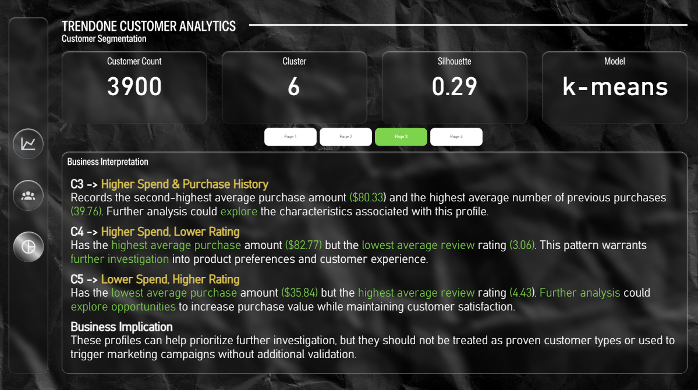
</p>
<p align="center">
  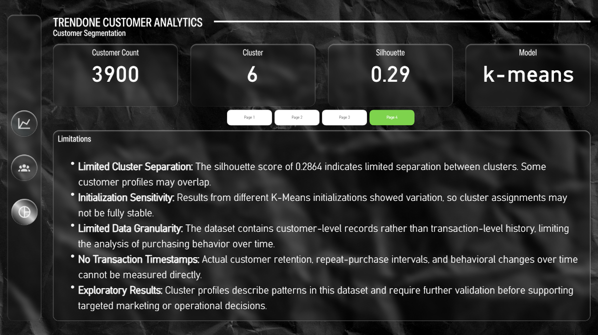
</p>

**What this page communicates:**
- Customer distribution by cluster.
- Average purchase amount by cluster.
- Cluster-level behavioral profiles.
- Model evaluation and limitations.

> **Dashboard note:** The recorded Purchase Amount should not be interpreted as total historical customer spending, revenue, or customer lifetime value without evidence that the dataset supports those definitions.

🔗 **Dashboard:** [Dashboard](powerbi/trendOne_analytics_dashboard.pbix)

---

## 💡 Business Recommendations

### 1. Investigate Subscription and Discount Rules

Review whether subscription status determines discount eligibility, whether the observed association is driven by business rules, and whether the same pattern exists in transaction-level data.

### 2. Improve Customer Value Measurement

Avoid relying on a single demographic attribute or purchasing variable as a complete measure of customer value. Incorporate historical net spending, transaction frequency over defined periods, returns, and margin data when available.

### 3. Validate Customer Profiles Before Acting on Them

Use the clusters to formulate follow-up questions rather than immediately assigning customers to campaigns. Evaluate segment stability and test whether the profiles correspond to meaningful business outcomes.

### 4. Strengthen the Data Foundation

Prioritize transaction timestamps, stable customer identifiers, product-level sales, discount and promotion identifiers, margin data, and customer activity history.

These additions would enable more reliable retention analysis, cohort analysis, customer value measurement, and campaign evaluation.

📄 **Detailed recommendations:** [`docs/07_recommendations.md`](docs/07_recommendations.md)

---

## ⚠️ Limitations & Data Requirements

The findings should be interpreted within the scope of the available dataset.

- **Limited data granularity:** The provided file contains one record per customer identifier rather than detailed transaction-level history.
- **No transaction timestamps:** Actual retention rates, purchase intervals, and time-based customer activity cannot be measured reliably.
- **Missing review ratings:** Thirty-seven Review Rating values are missing.
- **Statistical limitations:** The analysis does not establish causality, and non-significant results do not prove the absence of a relationship.
- **Segmentation limitations:** Cluster separation is limited, and the profiles have not been validated against operational outcomes.
- **Generalizability:** Findings describe this dataset and may not represent other customer populations or real business environments.

### Additional Data That Would Improve the Analysis

| Data Requirement                        | Analytical Value                               |
|-----------------------------------------|------------------------------------------------|
| Transaction ID and timestamp            | Cohort analysis, retention, purchase intervals |
| Stable customer ID across transactions  | Customer purchase history                      |
| Quantity, price, discount, net sales    | Purchase value and promotion analysis          |
| Product cost and margin                 | Profitability analysis                         |
| Promotion and eligibility identifiers   | Discount effectiveness investigation           |
| Acquisition and activity history        | Customer lifecycle analysis                    |
| Campaign exposure and response          | Campaign evaluation                            |

📄 **Full limitations:** [`docs/08_limitations.md`](docs/08_limitations.md)

---

## 📂 Repository Structure

```text
trendone_customer_analytics/
│
├── README.md
├── requirements.txt
│
├── data/
│   ├── raw/
│   │   └── trendOne_raw.csv
│   └── processed/
│       └── trendOne_prepared.csv
│
├── notebooks/
│   ├── 01_data_understanding.ipynb
│   ├── 02_data_preparation.ipynb
│   ├── 03_eda.ipynb
│   ├── 04_statistical_analysis.ipynb
│   └── 05_customer_segmentation.ipynb
│
├── sql/
│   ├── 01_schema.sql
│   ├── 02_data_validation.sql
│   ├── 03_customer_metrics.sql
│   ├── 04_business_questions.sql
│   └── 05_validation.sql
│
├── powerbi/
│   └── TrendOne_Customer_Analytics.pbix
│
├── docs/
│   ├── 01_business_case.md
│   ├── 02_business_questions.md
│   ├── 03_data_requirements.md
│   ├── 04_data_assessment.md
│   ├── 05_data_preparation.md
│   ├── 06_findings.md
│   ├── 07_recommendations.md
│   ├── 08_limitations.md
│   │
│   ├── architecture/
│   │   ├── analytical_workflow.png
│   │   ├── data_architecture.png
│   │   └── statistical_decision_flow.png
│   │
│   ├── img/
│   │   ├── trendone_banner.png
│   │   ├── dashboard _executive_overview_1_1.png
│   │   ├── dashboard _executive_overview_1_2.png
│   │   ├── dashboard _executive_overview_1_3.png
│   │   ├── dashboard _customer_behavior_2.png
│   │   ├── dashboard _customer_segmentation_3_1.png
│   │   ├── dashboard _customer_segmentation_3_2.png
│   │   ├── dashboard _customer_segmentation_3_3.png
│   │   └── dashboard _customer_segmentation_3_4.png
│   │
│   └── report/
│       ├── TrendOne_Customer_Analytics_Report.pdf
│       └── TrendOne_Customer_Analytics_Slide.pdf
│
└── outputs/
    ├── clustering_metrics.csv
    └── customer_segments.csv
```

*This tree is a proposed structure. Update it to match the files actually committed to GitHub. If a file or folder does not exist, remove it from the README or create it before publishing.*

---

## 🚀 Getting Started

### Prerequisites

- Python 3.12
- Jupyter Notebook or JupyterLab
- PostgreSQL or the SQL engine used in the project
- Power BI Desktop
- Git

### 1. Clone the Repository

```bash
git clone https://github.com/nigelalessan/trendone_customer_behavior_analysis
cd trendone_customer_analytics
```

### 2. Create a Virtual Environment

```bash
python -m venv .venv
```

Activate the environment:

**Windows PowerShell**

```powershell
.\.venv\Scripts\Activate.ps1
```

**macOS / Linux**

```bash
source .venv/bin/activate
```

### 3. Install Dependencies

```bash
pip install -r requirements.txt
```

### 4. Prepare the Dataset

Place the source dataset in the appropriate raw-data directory and follow the instructions in the data assessment and preparation notebooks.

[Dataset](https://github.com/amlanmohanty1/customer-trends-data-analysis-SQL-Python-PowerBI/blob/main/customer_shopping_behavior.csv)

### 5. Run the Analysis

Open Jupyter Notebook and run the notebooks in sequence:

1. `01_data_understanding.ipynb`
2. `02_data_preparation.ipynb`
3. `03_eda.ipynb`
4. `04_statistical_analysis.ipynb`
5. `05_customer_segmentation.ipynb`

Execute the SQL scripts using the database setup and import instructions documented in the repository.

### 6. Open the Dashboard

Open `powerbi/TrendOne_Customer_Analytics.pbix` in Power BI Desktop and update the data source path if required.


---

## 📚 Project Documentation

| Resource                                                            | Description                                  |
|---------------------------------------------------------------------|----------------------------------------------|
| [Business Case](docs/01_business_case.md)                           | Business context and project objectives      |
| [Business Questions](docs/02_business_questions.md)                 | Analytical questions and scope               |
| [Data Requirements](docs/03_data_requirements.md)                   | Data needed to answer the questions          |
| [Data Assessment](docs/04_data_assessment.md)                       | Data quality and feasibility assessment      |
| [Data Preparation](docs/05_data_preparation.md)                     | Cleaning decisions and preparation workflow  |
| [Findings](docs/06_findings.md)                                     | Analytical results and interpretations       |
| [Recommendations](docs/07_recommendations.md)                       | Proposed follow-up actions                   |
| [Limitations](docs/08_limitations.md)                               | Constraints and additional data requirements |
| [PDF Report](docs/reports/trendOne_customer_analytics_report.pdf)   | Consolidated analytical report               |


---

## 🔁 Reproducibility & Validation

The project separates data preparation, analytical notebooks, SQL scripts, and dashboard reporting to make the workflow easier to inspect and reproduce.

Validation includes:

- Checking identifiers, missing values, and duplicate records.
- Comparing relevant Python and SQL outputs.
- Reporting statistical effect sizes alongside significance tests.
- Recording the final K-Means configuration and evaluation metric.
- Documenting data limitations and assumptions.

Reproducibility depends on the availability of the source dataset, the documented environment, and the correct configuration of local data paths and database connections.

### Dataset Attribution

**Dataset name:** Customer Shopping Behavior  
**Source:** [Link](https://github.com/amlanmohanty1/customer-trends-data-analysis-SQL-Python-PowerBI/blob/main/customer_shopping_behavior.csv)  
**Publisher / author:** amlanmohanty1  

---

## 👤 About This Project

This project demonstrates practical application of data analytics techniques across data preparation, exploratory analysis, statistical testing, SQL, customer segmentation, and business intelligence reporting.

The emphasis is on analytical reasoning, transparent interpretation, reproducible workflows, and clear communication of limitations not simply producing charts or clustering outputs.

### 🔗 Connect

- **GitHub:** [nigelalessan](https://github.com/nigelalessan)
- **LinkedIn:** [Nigel Alessandro](https://www.linkedin.com/in/nigelalessan)

---

<p align="center">
  <i>Turning customer data into structured analysis, evidence-based interpretation, and better questions for business decision-making.</i>
</p>
